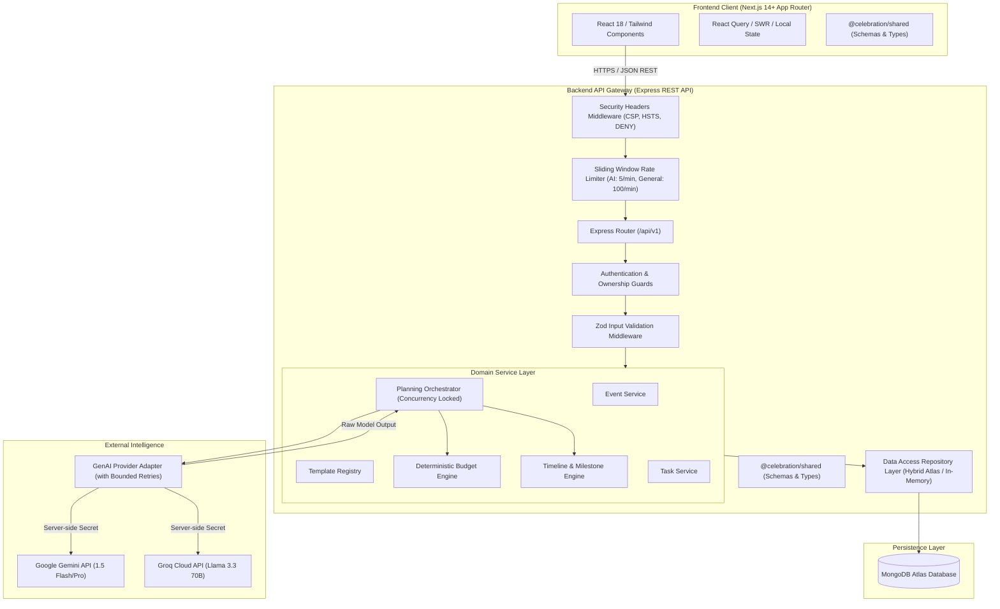
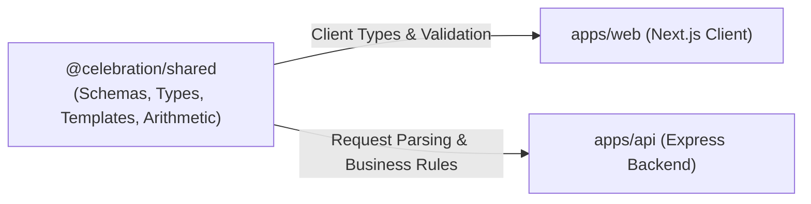
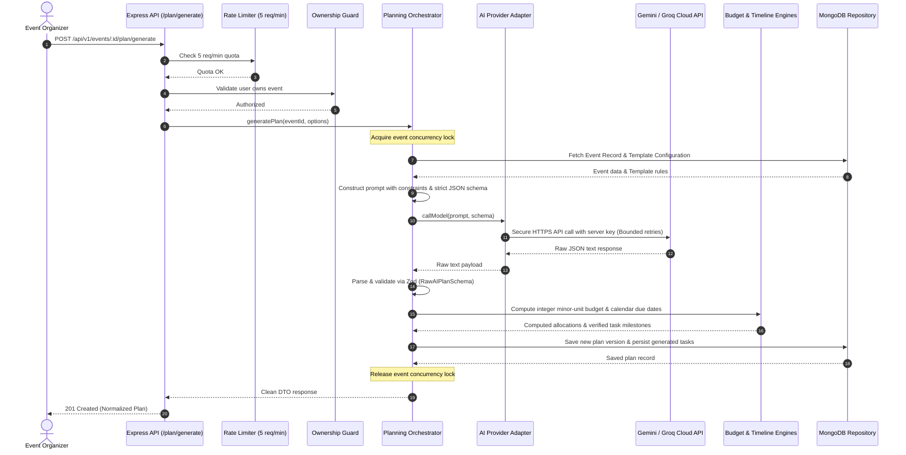
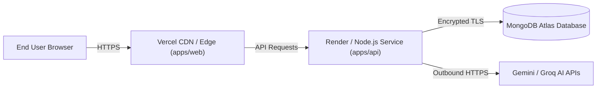

# Celebration & Event Planner — System Architecture

**Document Version:** 2.0.0 (Phase 4 Certified)  
**Target Environment:** Node.js 20+, Next.js 14+ App Router, Express, MongoDB Atlas, Cloud LLMs (Gemini / Groq)

---

## 1. High-Level System Architecture

The **Celebration & Event Planner** is architected as a **Modular Monolith** organized within an npm workspace monorepo. This balances simplicity of deployment and developer velocity with clean boundary isolation between the client presentation layer, server application logic, persistent database, and third-party AI inference providers.

---

## 2. Shared Type & Contract System

The `@celebration/shared` package serves as the single source of truth for TypeScript interfaces, Zod runtime validation schemas, domain types, and template definitions. Both the frontend Next.js application and the backend Express API consume this shared contract library.

---

## 3. GenAI Plan Generation Pipeline

---

## 4. Key Design Decisions & Trade-Offs

### 4.1 Decision: Single Universal Dashboard vs. Multi-App Architecture
- **Choice:** One universal dashboard adapting via configurable event templates.
- **Rationale:** Building separate apps for weddings, hackathons, and corporate events leads to code duplication, fractured maintenance, and architectural bloat. A single adaptive dashboard provides maximum reusability while dynamically surfacing relevant modules.

### 4.2 Decision: Deterministic Code vs. LLM Calculations
- **Choice:** Application code calculates all financial totals, minor-unit conversions, and calendar date offsets.
- **Rationale:** Large Language Models are probabilistic and prone to arithmetic hallucinations, rounding errors, and impossible date math.
- **Trade-off:** The planning orchestrator parses model percentages and applies deterministic algorithms to produce trustworthy numbers.

### 4.3 Decision: Integer Minor Units for Monetary Values
- **Choice:** All budgets and expenses are stored as 64-bit integer minor units (e.g. cents, paise).
- **Rationale:** Floating-point numbers introduce IEEE-754 precision errors (`0.1 + 0.2 = 0.30000000000000004`). Integer arithmetic guarantees financial exactness.

### 4.4 Decision: Monolith vs. Microservices
- **Choice:** Modular Monolith in an npm workspace.
- **Rationale:** Microservices introduce distributed complexity, network latency, and deployment friction that are counter-productive for this project.

---

## 5. Production Security & Resilience Architecture (Phase 4)

### 5.1 Strict Multi-Tenancy & Authorization
- Every event mutation and nested resource (tasks, budgets, expenses, plans) validates `event.ownerId === currentUser.id`.
- Cross-user attempts are immediately rejected with `403 FORBIDDEN`.
- Admins (`role: 'admin'`) retain multi-tenant support access.

### 5.2 Sliding Window Rate Limiting
- **GenAI Endpoints:** 5 requests per minute per client IP/user ID. Returns `429 Too Many Requests` with `Retry-After` header.
- **General Endpoints:** 100 requests per minute per client IP.

### 5.3 Concurrency Control
- `PlanningOrchestrator` maintains an active event lock set. Simultaneous duplicate generation calls for the same event reject with `409 Conflict`, preventing database races.

### 5.4 Production Fail-Fast Validation
- In `NODE_ENV=production`, server boot strictly asserts `MONGODB_URI`, `SESSION_SECRET`, and provider credentials. Silent fallback to in-memory store is prohibited in production.

### 5.5 Transient Error Resilience
- Gemini and Groq adapters implement bounded exponential backoff retries (max 2 retries) for transient HTTP 429 and 503 errors.

---

## 6. Deployment Architecture

- **Frontend:** Deployed to Vercel with automatic edge caching, SSR, and asset optimization.
- **Backend:** Deployed as a containerized Node.js service on Render with automatic health checks (`render.yaml`).
- **Database:** Hosted on MongoDB Atlas with IP access lists and encrypted storage.
- **AI Services:** Consumed via official HTTPS REST/SDK channels with server-side environment variables.
