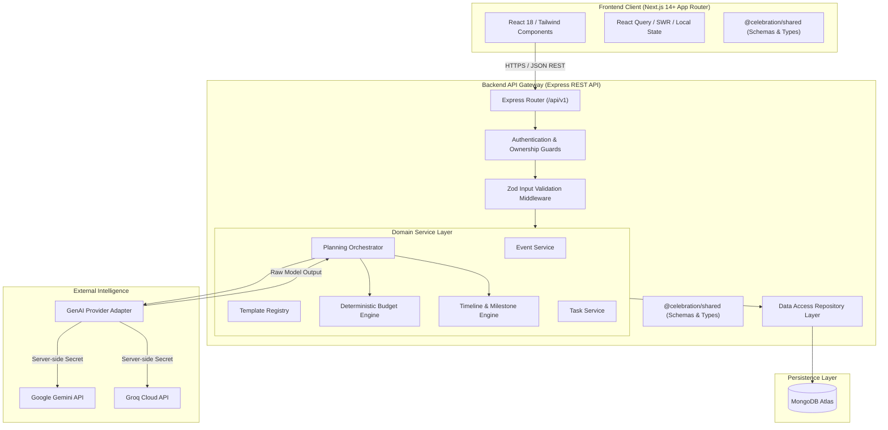
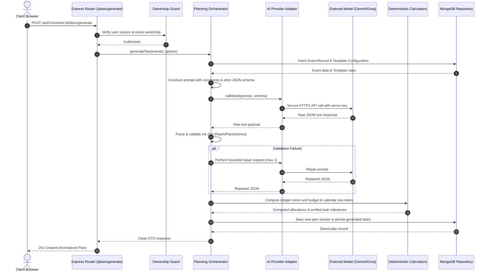
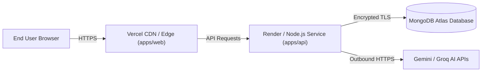

# Celebration & Event Planner — System Architecture

**Document Version:** 1.0.0  
**Target Environment:** Node.js 20+, Next.js 14+ App Router, Express, MongoDB Atlas, Cloud LLMs (Gemini / Groq)

---

## 1. High-Level System Architecture

The **Celebration & Event Planner** is architected as a **Modular Monolith** organized within an npm workspace monorepo. This balances simplicity of deployment and developer velocity with clean boundary isolation between the client presentation layer, server application logic, persistent database, and third-party AI inference providers.

---

## 2. Component Responsibilities & Boundaries

### 2.1 Presentation Layer (`apps/web`)
- **Technology:** Next.js 14+ App Router, React 18, Tailwind CSS, Lucide icons, Recharts.
- **Responsibilities:**
  - Rendering responsive, accessible user interfaces across desktop, tablet, and mobile.
  - Client-side navigation, form step wizard, and dynamic module card rendering based on active event templates.
  - Interactive task management (status transitions, priority filtering) and expense entry.
  - Handling loading skeletons, empty states, and user-facing error banners.
  - **Boundary Rule:** No direct database connections; no direct AI provider calls; zero storage of API keys or server secrets.

### 2.2 Shared Domain Package (`packages/shared`)
- **Technology:** TypeScript, Zod.
- **Responsibilities:**
  - Canonical type definitions for `Event`, `Plan`, `Task`, `Budget`, `Expense`, and `Template`.
  - Shared Zod validation schemas for request bodies, query parameters, and AI output payloads.
  - Shared domain constants (supported currencies, module IDs, task statuses).
  - **Boundary Rule:** Contains no runtime dependencies on Node.js or browser DOM APIs; usable anywhere.

### 2.3 Backend API Layer (`apps/api`)
- **Technology:** Node.js, Express, TypeScript, Mongoose/MongoDB Driver.
- **Responsibilities:**
  - Exposing versioned REST API endpoints (`/api/v1/*`).
  - Request validation and sanitization using Zod.
  - Enforcing authentication and event-level ownership guards.
  - Executing business logic in pure domain services.
  - Securely orchestrating AI calls and parsing structured JSON.
  - Performing deterministic budget calculations and date arithmetic.
  - **Boundary Rule:** Owns all communication with MongoDB and external AI providers.

### 2.4 Data Persistence Layer (MongoDB)
- **Technology:** MongoDB Atlas / Local MongoDB.
- **Responsibilities:**
  - Persistent document storage across collections: `users`, `events`, `plans`, `tasks`, `budgets`, `expenses`, `modules`.
  - Enforcing document integrity and query performance via strategic indexes.
  - Maintaining versioned history of AI-generated plans.

---

## 3. Data Flow & AI Orchestration Flow

### 3.1 AI Plan Generation Data Flow

---

## 4. Key Design Decisions & Trade-Offs

### 4.1 Decision: Single Universal Dashboard vs. Multi-App Architecture
- **Choice:** One universal dashboard adapting via configurable event templates.
- **Rationale:** Building separate apps for weddings, hackathons, and corporate events leads to code duplication, fractured maintenance, and architectural bloat. A single adaptive dashboard provides maximum reusability while dynamically surfacing relevant modules.
- **Trade-off:** The frontend UI must handle conditional rendering of modules cleanly based on template metadata.

### 4.2 Decision: Deterministic Code vs. LLM Calculations
- **Choice:** Application code calculates all financial totals, minor-unit conversions, and calendar date offsets.
- **Rationale:** Large Language Models are probabilistic and prone to arithmetic hallucinations, rounding errors, and impossible date math (e.g., February 31st or past deadlines).
- **Trade-off:** The planning orchestrator must parse model percentages and apply deterministic algorithms to produce trustworthy numbers.

### 4.3 Decision: Integer Minor Units for Monetary Values
- **Choice:** All budgets and expenses are stored as 64-bit integer minor units (e.g. cents, pence, paise).
- **Rationale:** Floating-point numbers introduce IEEE-754 precision errors (e.g. `0.1 + 0.2 = 0.30000000000000004`). Integer arithmetic guarantees financial exactness.
- **Trade-off:** Requires explicit conversion utilities when rendering display strings in the UI.

### 4.4 Decision: Monolith vs. Microservices
- **Choice:** Modular Monolith in an npm workspace.
- **Rationale:** Microservices introduce distributed complexity, network latency, and deployment friction that are counter-productive for this project. A modular monolith provides clear module boundaries and can be split later if scaling necessitates it.

---

## 5. Deployment Architecture

- **Frontend:** Deployed to Vercel with automatic edge caching, SSR, and asset optimization.
- **Backend:** Deployed as a containerized Node.js service on Render or Railway with automatic health checks.
- **Database:** Hosted on MongoDB Atlas with IP access lists and encrypted storage.
- **AI Services:** Consumed via official HTTPS REST/SDK channels with server-side environment variables.
