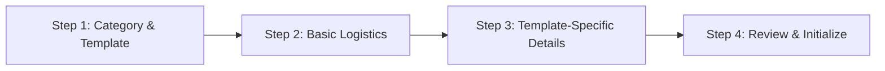

# Phase 1: Foundation, UI Shell, and Event Model

**Phase Status:** Completed  
**Estimated Complexity:** High (Core UI/UX, Component Architecture & Event Model)  
**Deliverables:** Responsive Next.js application shell, navigation system, event creation wizard, template registry, and shared domain models.

---

## 1. Overview & Objectives

The primary objective of **Phase 1** is to establish the production-grade frontend foundation and common event domain model for the Celebration & Event Planner. By the end of this phase, users will be able to navigate a polished, accessible dashboard, configure new events via an interactive guided wizard that dynamically adapts to selected event templates, and inspect template-specific planning modules.

Temporary demo/mock data is permitted during Phase 1 to validate UI behaviors before the database is connected in Phase 2, but it must be strictly isolated in clearly marked mock stores.

---

## 2. Shared Event Model & Type System

All entities must be authored in `@celebration/shared` and exported as both TypeScript interfaces and runtime Zod validation schemas.

### 2.1 Core Types (`@celebration/shared/src/types`)

```typescript
export type EventType = 
  | 'wedding' 
  | 'birthday' 
  | 'college_hackathon' 
  | 'community_event' 
  | 'corporate_conference' 
  | 'custom';

export type CurrencyCode = 'USD' | 'EUR' | 'GBP' | 'INR' | 'CAD' | 'AUD';

export type TaskStatus = 'pending' | 'in_progress' | 'completed' | 'blocked';
export type TaskPriority = 'low' | 'medium' | 'high' | 'critical';
export type TaskSource = 'template' | 'ai' | 'user';

export type ModuleId = 
  | 'overview'
  | 'budget'
  | 'timeline'
  | 'tasks'
  | 'recommendations'
  | 'reports'
  | 'guests'
  | 'vendors'
  | 'registrations'
  | 'teams'
  | 'judges'
  | 'speakers'
  | 'sessions'
  | 'volunteers'
  | 'sponsors'
  | 'equipment'
  | 'outreach'
  | 'impact_tracking';

export interface EventDetails {
  id: string;
  title: string;
  eventType: EventType;
  templateId: string;
  templateVersion: string;
  description: string;
  startDate: string; // ISO 8601
  endDate?: string;
  timezone: string;
  location: {
    type: 'physical' | 'virtual' | 'hybrid';
    address?: string;
    city?: string;
    country?: string;
    virtualUrl?: string;
  };
  currency: CurrencyCode;
  budgetLimitMinorUnits: number; // Stored as integer minor units (e.g. cents)
  expectedAttendance: number;
  preferences: Record<string, any>;
  customPrompt?: string; // Used when eventType === 'custom'
  activeModules: ModuleId[];
  createdAt: string;
  updatedAt: string;
}
```

### 2.2 Template Configuration Specification
Each template must adhere to the `EventTemplate` interface:

```typescript
export interface TemplateFieldDefinition {
  name: string;
  label: string;
  type: 'text' | 'number' | 'select' | 'multiselect' | 'boolean' | 'date';
  required: boolean;
  defaultValue?: any;
  options?: Array<{ label: string; value: string }>;
  helperText?: string;
}

export interface EventTemplate {
  id: string; // e.g. "wedding"
  version: string; // e.g. "1.0.0"
  name: string;
  category: string;
  description: string;
  icon: string;
  requiredFields: string[];
  optionalFields: string[];
  customFields: TemplateFieldDefinition[];
  defaultModules: ModuleId[];
  taskCategories: string[];
  suggestedTasks: Array<{
    title: string;
    category: string;
    daysBeforeEvent: number;
    priority: TaskPriority;
  }>;
  planningRules: {
    recommendedLeadTimeDays: number;
    budgetAllocationGuidance: Record<string, number>; // Percentage distribution
  };
  outputSections: string[];
}
```

---

## 3. Frontend Architecture & Page Routes

The frontend will use the Next.js 14+ App Router with React Server Components (RSC) where practical and Client Components (`'use client'`) for interactive forms and reactive widgets.

### 3.1 Route Hierarchy
- `/` — **Marketing / Landing Page & Dashboard Entry** (Overview of platform capabilities, quick start buttons).
- `/dashboard` — **Universal Dashboard Home** (Recent events, active tasks countdown, budget overview stats, upcoming milestones).
- `/events` — **My Events Directory** (Card and tabular list of planned events, filters by category and status, search bar).
- `/events/new` — **Create Event Wizard** (Multi-step guided intake with live template preview).
- `/events/[id]` — **Event Workspace Shell** (Dynamic dashboard hosting overview, timeline, tasks, budget, and active specialized modules).
- `/events/[id]/tasks` — **Task Management Board** (Kanban board and checklist views, filterable by category and status).
- `/events/[id]/budget` — **Budget & Expense Ledger** (Category breakdown, variance indicators, expense entry modal).
- `/events/[id]/timeline` — **Milestone Timeline** (Chronological preparation calendar with deadline indicators).
- `/events/[id]/modules/[moduleId]` — **Adaptive Category Module View** (E.g. guest list for weddings; team roster for hackathons).
- `/events/[id]/plan` — **AI Planning Workspace Shell** (Generation trigger button, plan comparison, revision prompt input).

### 3.2 Reusable UI Component System
Located in `apps/web/src/components/ui`:
1. **Layout Shell:** Sidebar navigation with collapsed/expanded states, mobile drawer, top breadcrumbs, user profile avatar.
2. **Card System:** `EventCard`, `StatCard`, `ModuleCard`, `TaskCard` with consistent elevation, borders, and hover states.
3. **Form Controls:** Accessible inputs, select dropdowns, multi-select tag pickers, date pickers, currency amount inputs, and toggle switches.
4. **State Indicators:**
   - `EmptyState`: Contextual illustration, friendly explanation, and primary call-to-action button.
   - `LoadingSkeleton`: Polished shimmering skeletons mirroring final layout geometries.
   - `ErrorState`: Alert box with error details and retry button.
   - `Badge`: Status badges (`pending`, `completed`, `blocked`, `estimate`, `quotation`, `actual`).
5. **Modal / Dialog:** Accessible keyboard-trapped modal dialogs for task creation and expense logging.

---

## 4. The Create Event Wizard Specification

The event creation wizard is the primary user journey in Phase 1. It consists of 4 distinct steps:



### Step 1: Category & Template Selection
- Visual card grid displaying the 5 canonical templates (`wedding`, `birthday`, `college_hackathon`, `community_event`, `corporate_conference`) plus `custom` card.
- Selecting a card immediately loads the template definition, previews the active modules, and reveals template-specific guidelines.
- Selecting `Custom Event` reveals a prominent natural-language prompt field: *"Describe your event in detail (e.g. A 2-day outdoor pottery and acoustic music retreat for 75 people)..."*

### Step 2: Basic Logistics
- Event Title, Event Date (or date range), Primary Timezone.
- Location Type (In-Person, Virtual, Hybrid) with address/city inputs.
- Currency selection (USD, EUR, GBP, INR, etc.) and Total Budget Cap (with automatic minor-unit conversion).
- Expected Attendance count.

### Step 3: Template-Specific Specialization
- Renders dynamic form controls defined in `template.customFields`:
  - **Wedding:** Ceremony style, catering preference, bridal party size, dietary constraints.
  - **Hackathon:** Tracks/themes, prize pool allocation, hardware lab needs, 24-hour catering requirements.
  - **Community Event:** Cleanup territory, municipal permit requirement flag, tool donation expectations.
  - **Corporate Conference:** Track count, keynote speaker target, sponsorship package tiers.
  - **Custom Event:** AI parsing prompt with user notes.

### Step 4: Review & Initialize
- High-level review summary showing projected module layout, suggested task count, and initial budget boundaries.
- Form validation run via Zod. Invalid fields trigger clear inline errors with focus shift.
- Submission initializes the event in local mock storage (Phase 1) and navigates to the event workspace shell.

---

## 5. Accessibility (a11y) & UX Standards
- **Keyboard Trapping & Tab Order:** Modals trap focus; tab order is logical and predictable across all wizard steps.
- **Form Labels:** Every `<input>`, `<select>`, and `<textarea>` has an associated `<label>` element with `htmlFor` bindings.
- **Focus Indicators:** High-contrast `focus-visible:ring-2` styling on all interactive elements.
- **Contrast Ratios:** Text meets WCAG AA 4.5:1 minimum contrast ratio against background surfaces in light and dark modes.
- **Status Indicators:** Never communicate state solely through color; pair color with text labels or icons (e.g. green checkmark + "Completed").

---

## 6. Phase 1 Acceptance Criteria & Verification

| Checkpoint | Requirement | Verification Method | Status |
| :--- | :--- | :--- | :--- |
| **AC 1.1** | Application starts cleanly with `npm run dev:web`. | Zero runtime crashes or compile errors in browser console. | **Verified (Pass)** |
| **AC 1.2** | Navigation between `/`, `/dashboard`, `/events`, `/events/new`, and `/events/[id]` functions seamlessly. | Click through all nav routes in browser; Next.js routes built. | **Verified (Pass)** |
| **AC 1.3** | Create Event wizard properly validates required fields. | Submit empty form; verify inline Zod error messages display. | **Verified (Pass)** |
| **AC 1.4** | Template selection dynamically alters Step 4 fields and active module cards. | Switch from "Wedding" to "Hackathon"; observe form inputs adapt. | **Verified (Pass)** |
| **AC 1.5** | Custom Event flow accepts open-ended natural language prompt. | Complete wizard using Custom Event; verify prompt is captured. | **Verified (Pass)** |
| **AC 1.6** | Static type check passes with 100% strictness. | Run `npm run typecheck` across root and apps/web (0 errors). | **Verified (Pass)** |
| **AC 1.7** | Zero API keys or secrets in source files or frontend bundles. | Automated inspection of `apps/web` and environment templates. | **Verified (Pass)** |

---

## 7. Implementation Execution Record

### 7.1 Pages & Routes Implemented
1. **`/` & `/dashboard`:** Universal Overview Dashboard displaying dynamic statistics derived from the local repository, 6 template quick-launch cards, upcoming events cards with progress and countdown, and interactive task checklist.
2. **`/events`:** My Events Directory with live search (title, city, description), category filtering (6 categories), status filtering, date/budget/title sorting, and archive/delete controls.
3. **`/events/new`:** 5-step guided wizard (Category, Logistics, Budget, Specialization, Review) with dynamic template fields, currency conversion, and review validation.
4. **`/events/[id]`:** Event Overview & AI Planning Workspace shell with 4 tabs (AI Workspace with prototype prompt revision stream, Task Checklist, Budget & Ledger with expense logging, Adaptive Template Modules).
5. **`/tasks`:** Cross-event chronological tasks view with status filtering, priority badges, and Add Task modal.
6. **`/resources`:** Adaptive resource management preview for participants, mentors, volunteers, and vendors.
7. **`/reports`:** Portfolio-wide reporting preview with aggregate budgets, task completion velocities, and printable table.
8. **`/settings`:** Regional currency and timezone preferences with a one-click "Reset Demo Data" action.

### 7.2 Verification Suite
- `16/16` automated tests passing in `packages/shared/test` covering:
  - Canonical template existence, unique stable IDs, and Zod schema conformity.
  - Event model validation (title bounds, ISO date validation, attendance bounds, budget bounds).
  - Financial arithmetic exactness, currency formatting, and budget overrun detection.
- `next build` executed with 11 static/dynamic pages compiled without warnings or errors.
