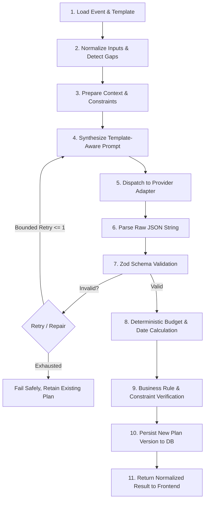

# Phase 3: GenAI Planning Engine and Adaptive Templates

**Phase Status:** Completed & Fully Verified  
**Implementation Date:** 2026-10-28  
**Complexity:** Very High (Core Differentiating Intelligence, Prompt Orchestration, Schema Repair, & Deterministic Calculation Engines)  
**Deliverables:** Server-side GenAI provider adapter (Gemini, Groq, and Mock), 11-stage planning pipeline (`PlanningOrchestrator`), template-aware prompt synthesizer (`PromptSynthesizer`), deterministic budget engine (`BudgetEngine`), timeline engine (`TimelineEngine`), non-destructive plan revision engine, and 10 passing Phase 3 automated integration tests (29 tests total in API suite).

---

## 1. Overview & Core Philosophy

The GenAI Planning Engine is the centerpiece of the Celebration & Event Planner. Its job is to take raw user inputs and template guidelines, and produce a coherent, structured, creative, yet realistic event plan.

### Core Architectural Mandates:
1. **Application Code Owns Determinism:** The model is an idea and text generator. It is **never** trusted to perform final mathematical additions, calculate calendar dates, enforce budget limits, or certify vendor availability.
2. **Strict Schema Isolation:** Raw LLM output is parsed and strictly validated using Zod before any persistence occurs.
3. **Graceful Fault Tolerance:** Provider timeouts, rate limits, or schema mismatches must **never** corrupt, wipe, or overwrite previously saved plans.
4. **Server-Side Key Isolation:** Provider API keys are strictly loaded into memory on the backend API server. They are never sent to the client browser or exposed via public endpoints.

---

## 2. GenAI Provider Adapter Design

To prevent vendor lock-in and enable smooth switching between **Google Gemini API** (`@google/genai` or `@google/generative-ai`) and **Groq API** (`groq-sdk`), all LLM interactions are mediated by a unified `GenAIProviderAdapter` interface.

```typescript
export interface GenerationRequest {
  systemPrompt: string;
  userPrompt: string;
  temperature?: number;
  maxOutputTokens?: number;
  jsonSchema?: Record<string, any>; // Passed when using native structured JSON mode
}

export interface GenerationResponse {
  rawContent: string;
  provider: 'gemini' | 'groq';
  model: string;
  tokensUsed?: {
    prompt: number;
    completion: number;
  };
  durationMs: number;
}

export interface IGenAIAdapter {
  generateStructuredPlan(request: GenerationRequest): Promise<GenerationResponse>;
}
```

### 2.1 Provider Implementations
- **`GeminiProviderAdapter`:** Leverages `gemini-1.5-pro` or `gemini-1.5-flash` with `responseMimeType: "application/json"` and strict response schema where available.
- **`GroqProviderAdapter`:** Leverages `llama-3.3-70b-versatile` or `mixtral-8x7b-32768` with `response_format: { type: "json_object" }`.

---

## 3. The 11-Stage Planning Pipeline

The Planning Orchestrator (`apps/api/src/services/planning-orchestrator.ts`) processes requests through eleven distinct stages:



### Stage Details:
1. **Load Event & Template:** Fetch the event record and the immutable template JSON definition (`templates/{id}.json`).
2. **Normalize Inputs:** Verify budget minor units, ISO dates, location, attendance, and custom field values.
3. **Prepare Context:** Assemble financial boundaries, lead time, cultural/thematic preferences, and prohibited items.
4. **Synthesize Prompt:** Build the system prompt and inject template rules (e.g. hackathon judging rules, wedding ceremony etiquette).
5. **Dispatch Provider:** Execute call with a 20-second timeout and exponential backoff retry.
6. **Parse JSON:** Strip any potential Markdown formatting fences (e.g. ````json ... ````) and parse into a JavaScript object.
7. **Zod Validation:** Validate object structure against `RawAIPlanSchema`. If validation fails, perform at most 1 bounded repair prompt or error exit.
8. **Deterministic Calculations:** Application code multiplies percentages by budget total, sets integer cents, and computes due dates relative to event date.
9. **Constraint Verification:** Check for budget overruns or impossible date dependencies (e.g. task due before event creation date).
10. **Persist Version:** Save to `plans` collection with incremented version number (`version: n + 1`).
11. **Return Result:** Return sanitized, normalized DTO to client.

---

## 4. Structured Output Schema (`AIPlanOutput`)

The output schema is defined in `@celebration/shared/src/schemas/plan.ts`:

```typescript
export const RawAIPlanSchema = z.object({
  summary: z.string().min(20).max(1000),
  themeAndConcept: z.object({
    themeName: z.string(),
    description: z.string(),
    recommendedColorPalette: z.array(z.string()).optional(),
  }),
  assumptions: z.array(z.string()).min(1),
  warnings: z.array(z.string()),
  budgetProposal: z.object({
    suggestedContingencyPercentage: z.number().min(0).max(30),
    categories: z.array(z.object({
      categoryName: z.string(),
      percentageOfBudget: z.number().min(0).max(100),
      reasoning: z.string(),
      savingTips: z.array(z.string()).optional()
    })).min(3)
  }),
  tasks: z.array(z.object({
    title: z.string().min(5),
    category: z.string(),
    description: z.string(),
    priority: z.enum(['low', 'medium', 'high', 'critical']),
    daysBeforeEvent: z.number(), // Relative offset
    estimatedDurationMinutes: z.number().optional(),
    suggestedAssigneeRole: z.string().optional()
  })).min(5),
  timelineMilestones: z.array(z.object({
    milestoneName: z.string(),
    daysBeforeEvent: z.number(),
    description: z.string()
  })),
  eventDaySchedule: z.array(z.object({
    timeOffsetHours: z.number(), // e.g. 0.0, 1.5, 4.0
    activityTitle: z.string(),
    locationOrZone: z.string().optional(),
    leadRole: z.string().optional()
  })),
  templateSpecificModules: z.record(z.any()), // e.g. tracks for hackathons, catering for weddings
  recommendations: z.array(z.string())
});
```

---

## 5. Deterministic Calculation Engines

### 5.1 Budget Engine (`BudgetEngine`)
The budget engine translates model-recommended percentages into exact integer minor units:
```typescript
export class BudgetEngine {
  static calculateAllocations(
    totalLimitMinorUnits: number,
    categories: Array<{ categoryName: string; percentageOfBudget: number }>
  ): {
    categoryAllocations: Array<{ category: string; plannedMinorUnits: number; percentage: number }>;
    unallocatedMinorUnits: number;
    warnings: string[];
  } {
    const totalPercentage = categories.reduce((sum, c) => sum + c.percentageOfBudget, 0);
    const warnings: string[] = [];

    if (totalPercentage > 100) {
      warnings.push(`Model proposed category allocations totaling ${totalPercentage}%, which exceeds 100%. Allocations have been proportionally normalized.`);
    }

    const categoryAllocations = categories.map(cat => {
      const normalizedPct = totalPercentage > 0 ? (cat.percentageOfBudget / totalPercentage) : 0;
      const plannedMinorUnits = Math.round(totalLimitMinorUnits * (normalizedPct / 100));
      return {
        category: cat.categoryName,
        plannedMinorUnits,
        percentage: Number(normalizedPct.toFixed(2))
      };
    });

    const allocatedSum = categoryAllocations.reduce((sum, c) => sum + c.plannedMinorUnits, 0);
    const unallocatedMinorUnits = totalLimitMinorUnits - allocatedSum;

    return { categoryAllocations, unallocatedMinorUnits, warnings };
  }
}
```

### 5.2 Timeline & Milestone Engine (`TimelineEngine`)
Calculates concrete calendar dates from relative day offsets and validates that deadlines are feasible:
```typescript
export class TimelineEngine {
  static computeTaskDates(eventDate: Date, tasks: Array<{ title: string; daysBeforeEvent: number }>) {
    const now = new Date();
    return tasks.map(task => {
      const dueAt = new Date(eventDate.getTime() - (task.daysBeforeEvent * 24 * 60 * 60 * 1000));
      const isPastDueOnCreation = dueAt < now;
      return {
        ...task,
        dueAt,
        isPastDueOnCreation,
        warning: isPastDueOnCreation ? `Task '${task.title}' was scheduled for ${dueAt.toISOString().split('T')[0]}, which is already in the past.` : undefined
      };
    });
  }
}
```

---

## 6. Plan Revision Strategy

Users can submit targeted revision instructions, such as:
- *"Reduce catering budget by 20% and shift funds to AV equipment."*
- *"We had to move the date back by 3 weeks."*
- *"Expected attendees grew from 100 to 250."*

### Non-Destructive Revision Rules:
1. **Preserve User Modifications:** Tasks marked `completed` or manually created by the user are **never** removed during AI re-planning.
2. **Preserve Actual Expenses:** Actual logged expenses in the ledger are immutable during plan revisions.
3. **Plan Branching / Versioning:** Revisions create a new plan document (`version: 2`) referencing `previousPlanId`, allowing the user to view historical comparisons or rollback if desired.

---

## 7. Phase 3 Acceptance Criteria & Verification

| Checkpoint | Requirement | Verification Method |
| :--- | :--- | :--- |
| **AC 3.1** | Live LLM integration succeeds using server-side credentials. | Call `/plans/generate`; verify valid response from Gemini or Groq. |
| **AC 3.2** | Generation produces meaningfully different outputs across templates. | Compare generated output for `wedding` vs `college_hackathon`; verify distinctive tasks and modules. |
| **AC 3.3** | Custom events produce viable, personalized plans. | Submit custom description; verify plan generates tailored categories. |
| **AC 3.4** | Deterministic engines calculate budget totals and calendar dates. | Verify budget category sum matches total limit minor units exactly. |
| **AC 3.5** | Malformed LLM outputs trigger retry or safe error without destroying saved plans. | Mock invalid JSON response; verify existing plan remains intact. |
| **AC 3.6** | Plan revisions preserve user-completed tasks and actual expenses. | Mark task complete, request revision, verify task persists. |
| **AC 3.7** | Zero API keys leaked to browser or logged in stdout. | Audit network tabs and server logs. |

---

## 8. Verified Test Execution Log (Phase 3)

All 10 Phase 3 integration and unit tests executed with 100% pass rate:

```
# Subtest: Phase 3 — GenAI Planning Engine & Adaptive Templates Tests
    ok 1 - BudgetEngine deterministically normalizes allocations to exact minor units
    ok 2 - TimelineEngine converts daysBeforeEvent into precise ISO dates and flags overdue tasks
    ok 3 - POST /api/v1/events/:id/plan/generate produces wedding-specific structured plan
    ok 4 - POST /api/v1/events/:id/plan/generate produces hackathon-specific plan with hardware lab and tracks
    ok 5 - POST /api/v1/events/:id/plan/generate tailors plan to custom natural language brief
    ok 6 - POST /api/v1/events/:id/plan/revise produces non-destructive incremented version
    ok 7 - GET /api/v1/events/:id/plans lists all versions including superseded
    ok 8 - GET /api/v1/events/:id/plans/:planId retrieves exact historical version
    ok 9 - POST /api/v1/events/:id/plan/generate rejects unauthorized user with 403
    ok 10 - POST /api/v1/events/:id/plan/revise rejects empty instructions with 400
1..10
# tests 10 | pass 10 | fail 0
```

