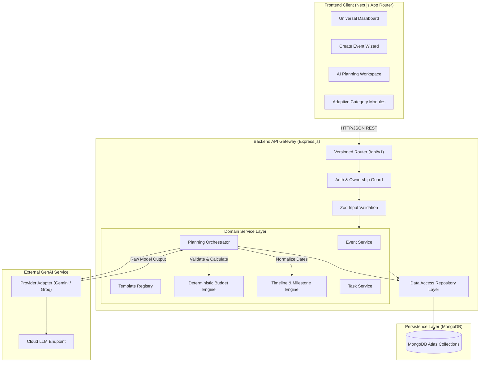
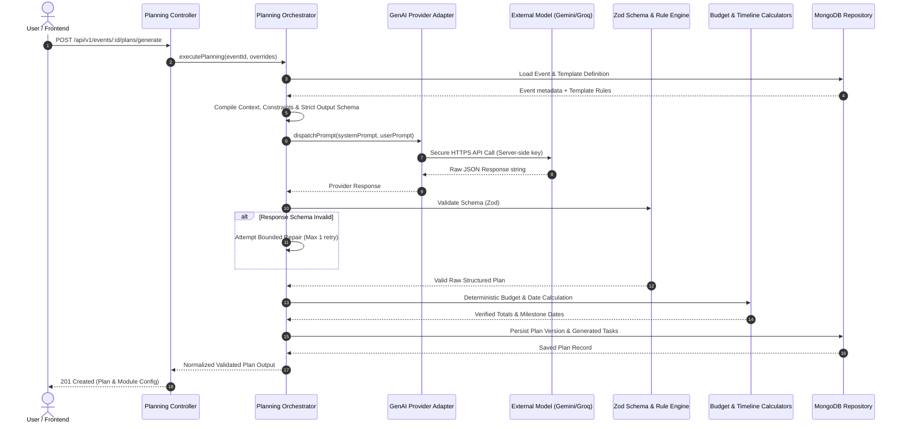

# Celebration & Event Planner — Master Project Specification & Blueprint

**Version:** 1.0.0  
**Status:** Approved Architecture Blueprint  
**System Architecture:** Modular Monolith (Next.js App Router + Node.js/Express + MongoDB + GenAI Provider Adapter)

---

## 1. Project Summary & Problem Statement

### 1.1 Project Summary
**Celebration & Event Planner** is an intelligent, universal Generative AI-powered event planning and lifecycle management platform. The platform converts high-level natural language requirements and structured user parameters into personalized, budget-conscious, milestone-driven, editable event execution plans.

### 1.2 Problem Statement
Organizing events of any scale—from family celebrations to technical hackathons and large-scale corporate conferences—demands coordinating disparate schedules, complex multi-category budgets, volatile vendor quotes, participant logistics, safety/permitting requirements, and contingent execution checklists. Traditional planning relies on fragmented spreadsheets, generic static templates, and isolated chat threads. Generic checklists fail because they do not reflect specific budgets, cultural traditions, attendee counts, or regulatory constraints.

**Celebration & Event Planner** resolves this fragmentation by uniting deterministic application rules (budget tracking, date arithmetic, status workflows, data persistence) with adaptive generative intelligence (creative themes, milestone breakdown, contingency identification, specialized category modules).

### 1.3 Core Architectural Principle
> **ONE UNIVERSAL DASHBOARD + ONE SHARED PLANNING ENGINE + CONFIGURABLE EVENT TEMPLATES**

The platform rejects category-specific siloed applications. Instead, it maintains a single unified planning engine and a modular, adaptive dashboard. A wedding, a college hackathon, a community cleanup, and a corporate conference share the exact same foundation (budget, timeline, tasks, reports) while dynamically surfacing category-specific operational modules (e.g., table seating & caterers for weddings; judging rubrics & AV gear for hackathons).

---

## 2. Target Users & Event Categories

### 2.1 Target Personas
1. **Private Hosts & Families:** Non-professional organizers planning milestone celebrations (weddings, anniversaries, birthdays, retirement parties) needing budget guidance, etiquette checkpoints, and vendor coordination.
2. **Student & Academic Organizers:** College clubs and campus committees orchestrating hackathons, symposiums, or cultural fests with strict sponsor budgets, venue permissions, and judge management.
3. **Community & Non-Profit Leaders:** Civic organizers coordinating volunteer drives, neighborhood cleanups, charity galas, and awareness rallies where resource donations, volunteer safety, and permitting are paramount.
4. **Corporate Planners & Coordinators:** Small-to-midsize business coordinators organizing internal offsites, seminars, trade shows, and annual summits requiring schedule synchronizations and executive reports.

### 2.2 Event Categories & Template Coverage

| Event Category | Identifier | Primary Objective | Distinguishing Specialized Modules |
| :--- | :--- | :--- | :--- |
| **Wedding & Anniversary** | `wedding` | Sacred & celebratory milestones | Guests/RSVP, Vendor Management, Catering/Menu, Ceremonies, Décor/Theme, Photography |
| **Birthday & Private Party** | `birthday` | Intimate or festive social gathering | Guest List, Entertainment/Activities, Cake & Refreshments, Invitations, Theme & Favors |
| **College Hackathon** | `college_hackathon` | Time-bounded technical competition | Registrations, Teams & Mentors, Judges & Scoring, Sessions/Workshops, Sponsors & Prizes, Lab Equipment/Network |
| **Community & Social Event**| `community_event` | Civic impact or neighborhood gathering | Volunteers, Outreach/Publicity, Municipal Permits, Safety & First Aid, Equipment/Logistics, Impact Tracking |
| **Corporate Conference** | `corporate_conference`| Professional networking & knowledge exchange | Keynote Speakers, Attendee Tracks, Sponsorship Tiers, Travel/Lodging, AV & Stage Operations, Badge Check-in |
| **Custom Event** | `custom` | Any novel or composite event | Natural-language classification mapping to dynamic modules, open-ended checklist, adaptive budget |

---

## 3. Functional & Non-Functional Requirements

### 3.1 Functional Requirements
- **FR-1 Event Creation Wizard:** Multi-step accessible intake capturing Title, Event Type/Template, Dates/Duration, Location (Physical/Virtual), Currency, Total Budget Limit, Expected Attendance, and Custom Preferences.
- **FR-2 AI Plan Generation:** Server-orchestrated prompt synthesis requesting strictly typed JSON containing overview, assumptions, warnings, budget allocations, tasks, and specialized modules.
- **FR-3 Deterministic Budget Engine:** Application-calculated minor-unit arithmetic distinguishing *unverified estimates*, *verified quotations*, and *actual spending*, preventing hidden floating-point rounding errors.
- **FR-4 Dynamic Timeline & Milestone Engine:** Relative scheduling (days before/after event date) converted to concrete calendar dates with dependency enforcement and collision warnings.
- **FR-5 Task Lifecycle Management:** Interactive task boards/lists supporting statuses (`pending`, `in_progress`, `completed`, `blocked`), priorities, category grouping, assignees, and source tracking (`template`, `ai`, `user`).
- **FR-6 Plan Revision Engine:** Parameterized re-planning allowing users to modify parameters (e.g. cut budget by 20%, shift date forward two weeks, increase head count) while preserving manual edits.
- **FR-7 Persistence & Versioning:** Full event and plan lifecycle persisted in MongoDB, retaining historical plan revisions.
- **FR-8 Reporting & Export:** Generation of clean printable summaries, PDF/JSON export payloads, and shareable read-only snapshots.

### 3.2 Non-Functional Requirements
- **NFR-1 Security & Zero Secret Leakage:** Zero API keys or secrets exposed to the browser. All LLM calls handled through server-side gateway adapters.
- **NFR-2 Reliability & Graceful Degradation:** LLM provider timeouts, rate-limits, or malformed outputs never corrupt or overwrite existing stored plans. Graceful fallback with human-readable error messages.
- **NFR-3 Determinism Over Hallucination:** Application code validates arithmetic, dates, and schemas. The model never dictates final mathematical totals or confirmed booking realities.
- **NFR-4 Performance:** Core API responses under 150ms; AI streaming or bounded generation completing within 15 seconds with explicit UI loading indicators.
- **NFR-5 Accessibility:** WCAG 2.1 AA compliance: semantic landmarks, accessible form controls, keyboard navigation, visible focus indicators, and screen-reader summaries for charts.
- **NFR-6 Maintainability & Typings:** 100% strict TypeScript across shared package, backend API, and frontend web client.

---

## 4. System Architecture

### 4.1 Monorepo Structure
```
celebration-event-planner/
├── apps/
│   ├── web/                    # Next.js 14+ App Router, React 18, Tailwind CSS
│   └── api/                    # Node.js, Express, TypeScript REST API
├── packages/
│   └── shared/                 # Shared TypeScript interfaces, Zod schemas, constants
├── templates/                  # Canonical versioned event template JSON configurations
├── docs/                       # Architectural diagrams and design specifications
├── WHOLE-PROJECT.md            # Master Blueprint (This document)
├── PHASE-0-INITIALIZATION.md   # Phase 0 execution findings and setup record
├── PHASE-1-FOUNDATION.md       # Phase 1 UI shell, forms, and template engine specification
├── PHASE-2-BACKEND-DATABASE.md # Phase 2 REST API, MongoDB data layer, and CRUD specification
├── PHASE-3-GENAI-ENGINE.md     # Phase 3 LLM adapter, structured output, and validation engine
├── PHASE-4-INTEGRATION-DEPLOYMENT.md # Phase 4 E2E flows, tests, security, and deployment
├── ARCHITECTURE.md             # Detailed architectural trade-offs and component topology
├── API-SPECIFICATION.md        # REST API endpoints, schemas, and error contracts
├── DATA-MODEL.md               # MongoDB schema definitions, indexes, and money rules
├── TESTING-STRATEGY.md         # Unit, API, AI-mocking, and E2E test plan
├── README.md                   # Installation, environment, and development guide
├── .env.example                # Sanitized environment template
└── .gitignore                  # Git exclusions for dependencies, builds, and secrets
```

### 4.2 Architectural Topology Flow


---

## 5. Generative AI Workflow & Planning Engine

### 5.1 AI Orchestration Pipeline


### 5.2 Strict Boundaries on AI Output
1. **Never Trust LLM Mathematics:** The model outputs recommended category percentage weights and baseline estimate suggestions. The deterministic application code calculates integer minor unit allocations (`plannedTotalMinorUnits`, `categoryAllocations`).
2. **Never Trust Hallucinated Real-World Facts:** The model is explicitly forbidden from claiming confirmed bookings, legally cleared municipal permits, or real-time vendor availability. Unverified amounts are labeled `estimateStatus: "unverified_estimate"`.
3. **Explicit Assumptions & Warnings:** The model must emit an array of operational assumptions (e.g., "Assumes indoor catering hall with existing power hookups") and regulatory warnings (e.g., "Municipal noise permit required after 10:00 PM").

---

## 6. Event Template Strategy

Event templates are stored as versioned, declarative JSON artifacts. They govern:
1. **Required vs. Optional Fields:** Modifying the input wizard (e.g., Hackathons require `hardwareRequirements`, Weddings require `cateringPreference`).
2. **Task Categorization:** Distinct work-breakdown structures (`Ceremony`, `Logistics`, `Sponsorship`, `Permits`).
3. **Active Dashboard Modules:** Dynamic UI visibility flags (e.g., `modules: ["guests", "catering", "vendors"]`).
4. **Planning Engine Prompts:** Injected domain guidelines instructing the model on domain-specific standards.

---

## 7. Database Entities & Persistence

The primary MongoDB collections:
- `users`: User identity, profile, and role configurations.
- `events`: Root event entity storing parameters, dates, currency, budget cap, and template reference.
- `plans`: Versioned plans containing summary, assumptions, warnings, and AI model telemetry.
- `tasks`: Granular action items with dependencies, due dates, categories, and completion state.
- `budgets`: Event budget allocations by category with currency specifications.
- `expenses`: Discrete ledger items tracking estimates, formal quotations, and actual disbursements.
- `modules`: Dynamic store for template-specific data (e.g., RSVP list, hackathon tracks, volunteer rosters).

---

## 8. Four-Phase Master Implementation Roadmap

### Phase 1: Foundation, UI Shell, and Event Model
- **Goal:** Runnable web application with responsive dashboard shell, accessible event wizard, versioned template configurations, and typed contracts.
- **Frontend Focus:** Next.js App Router, Tailwind layout, Home Dashboard, Create Event Wizard, My Events, and Adaptive Event Workspace.
- **Data Models:** Versioned template JSON schema, shared Zod schemas, mock data fallback.
- **Criteria:** All routes navigable, template switching changes visible fields and modules, custom event natural language form operational, 100% clean type check.

### Phase 2: Backend, Database, and Event Management
- **Goal:** Production-grade Express REST API connected to MongoDB Atlas with transactional domain services.
- **Backend Focus:** Route/Controller/Service/Repository layers, input validation middleware, error handling, rate limiting.
- **Persistence:** CRUD for events, tasks, budgets, expenses, and plans.
- **Criteria:** Data survives browser refresh, server strictly validates inputs, soft-delete archiving supported, automated API integration tests pass.

### Phase 3: GenAI Planning Engine and Adaptive Templates
- **Goal:** Live LLM integration generating structured, template-specific, mathematically verified plans.
- **Engine Focus:** Provider adapter (Gemini/Groq), prompt crafting, structured JSON schema validation, deterministic budget/timeline calculators.
- **Adaptive Modules:** Unique modules for Wedding, Birthday, Hackathon, Community Event, and Corporate Conference.
- **Criteria:** Live model produces valid plans; provider errors do not corrupt existing plans; application code computes all financial totals; custom events receive meaningful fallback proposals.

### Phase 4: Integration, Testing, Security, and Deployment
- **Goal:** Production-hardened, accessible, deployable platform with complete E2E workflows and verified demo journeys.
- **Audit:** Security review (CORS, helmet, zero secret leaks), accessibility audit (WCAG AA), responsive mobile testing.
- **Testing:** Comprehensive test suite (Unit, Integration, AI Mocking, E2E user journeys).
- **Deployment:** Deployment configurations for Vercel (Web) and Render (API), verified environment variables, comprehensive documentation.
- **Criteria:** End-to-end demo journeys pass seamlessly for Wedding, Hackathon, and Community Cleanup.

---

## 9. MVP Scope & Explicit Non-Goals

### 9.1 In-Scope MVP Capabilities
- Guided multi-step creation for 5 specific categories + 1 custom open-ended category.
- Server-side GenAI plan generation with strict schema enforcement.
- Deterministic budget allocation, expense ledger, and budget variance detection.
- Interactive task management with timeline milestones and dependency tracking.
- Interactive plan revision preserving user-created tasks and expenses.
- Persistent storage in MongoDB with plan revision history.
- Dynamic module display adapted to the active event template.

### 9.2 Explicit Non-Goals (Deferred to Post-MVP)
- Live payment processing or escrow integration.
- Direct booking of third-party vendors or real-time vendor availability scraping.
- Native iOS/Android mobile builds (PWA / responsive web only for MVP).
- Multi-agent autonomous negotiations or recursive LLM agent swarms.
- Vector database / RAG implementations prior to validated domain knowledge base requirements.
- Full corporate CRM or automated unsolicited email marketing campaigns.

---

## 10. Acceptance & Definition of Done
The project is complete when:
1. Both `web` and `api` run cleanly with zero errors on standard Node 20+ environments.
2. A user can create any of the 5 supported event types or a custom event, generate a valid AI plan, customize tasks and expenses, and revise the plan.
3. Budget and timeline arithmetic are strictly deterministic and provably correct.
4. All secrets remain strictly server-side; automated checks confirm zero credential leakage.
5. Automated test suites cover domain logic, API routes, and schema validation.
6. The entire four-phase roadmap has been executed sequentially and documented honestly.
